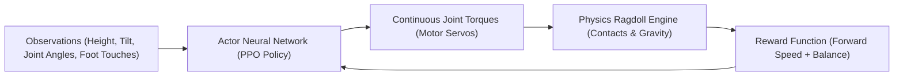

# 🏃‍♂️ AI 100m Dash: Humanoid Reinforcement Learning Guide

Inspired by the viral [AI Warehouse YouTube Video: "AI vs. AI in 100m Dash (deep reinforcement learning)"](https://youtu.be/pJPdW8WWAso).

This guide explains how deep reinforcement learning teaches a physics-based ragdoll humanoid to walk, balance, and sprint from scratch, and provides an in-depth breakdown of whether high-compute hardware is required.

---

## ⚡ Does It Require a High-Compute Computer?

### Short Answer
- **To run our interactive demo or inspect trained agents:** **NO.** It runs at silky-smooth 60 FPS on any modern laptop (including Intel Core Ultra integrated graphics) directly in your browser or Python.
- **To train a full 3D humanoid from scratch in Unity ML-Agents or MuJoCo:** **YES, substantial compute is typically required** if you want it done in a reasonable timeframe.

---

### Detailed Compute Comparison Breakdown

| Environment / Stack | Hardware Setup | Number of Parallel Agents | Typical Training Time |
| :--- | :--- | :--- | :--- |
| **GPU-Accelerated (NVIDIA Isaac Gym / Brax / Isaac Lab)** | NVIDIA RTX 3080 / 4090 (CUDA) | **2,048 – 4,096 parallel clones** | **15 – 45 minutes** ⚡ |
| **Unity ML-Agents (AI Warehouse's setup)** | Desktop 8-core to 16-core CPU + GPU | **16 – 64 parallel clones** | **8 – 24 hours** (Overnight) |
| **Standard MuJoCo CPU (Gymnasium `Humanoid-v4`)** | Standard Laptop CPU (4–8 threads) | 4 – 8 parallel CPU workers | **24 – 72 hours** |
| **Our Interactive Demo (`humanoid_dash_simulation.html`)** | Any Laptop / Desktop / Browser | 4 – 12 agents (Kinematic Physics) | **Instant / 60 FPS** |

---

### Why is 3D Humanoid RL Computationally Demanding?

1. **Massive Continuous State & Action Space:**
   - A realistic 3D humanoid model has **15–25 rigid body segments** and **14–28 motorized joints** (hips, knees, ankles, spine, neck, shoulders, elbows).
   - The neural network policy must receive 40 to 80 continuous inputs (orientations, angular velocities, linear velocities, contact forces) and output continuous motor torques ($\tau_i \in [-1, 1]$) at 50 to 100 Hz.

2. **The "Faceplant" Sparse Reward Trap:**
   - At Generation 0, an untrained neural network outputs random torques.
   - Because gravity is unforgiving, **99.9% of random actions result in a catastrophic fall within 0.2 seconds**.
   - The agent takes millions of failed attempts just to discover that extending a leg prevents falling.

3. **Sample Complexity (10M – 50M Physics Steps):**
   - High-speed coordinated bipedal sprinting requires learning subtle counterbalancing (e.g. forward torso tilt, pendulum arm swings, elastic knee flexion).
   - Algorithms like **PPO (Proximal Policy Optimization)** typically need **10,000,000 to 50,000,000 environment steps** to discover a stable sprint limit cycle.
   - At 60 FPS on a single CPU thread, 20 million steps would take over **92 hours of non-stop simulation**!

---

## 🔬 How AI Warehouse Built the 100m Dash Video

In the video, the creator uses **Unity with ML-Agents** (Unity's open-source machine learning framework built on PyTorch and C# PhysX):



### 1. Reward Engineering (The Secret Sauce)
If you only reward forward distance, humanoids learn bizarre exploits—like doing continuous somersaults, dragging their heads on the floor, or launching into cartwheels.

To force humanoids to look like Olympic runners, the reward function is shaped as:

$$R_t = \underbrace{w_v \cdot v_x}_{\text{Speed Reward}} + \underbrace{w_u \cdot \cos(\theta)}_{\text{Upright Bonus}} - \underbrace{w_e \cdot \sum \tau_i^2}_{\text{Energy Efficiency}} - \underbrace{w_f \cdot \mathbb{I}(\text{fall})}_{\text{Fall Penalty}}$$

- $v_x$: Forward velocity (encourages sprinting).
- $\cos(\theta)$: Keeps the spine aligned vertically with an aerodynamic forward lean.
- $\sum \tau_i^2$: Prevents violent, spastic joint vibration by penalizing wasted electrical motor power.
- Arm swing incentive: Rewarding counter-lateral momentum so the arms swing opposite to the legs.

### 2. Multi-Agent Parallel Cloning
Rather than running one humanoid on one track, creators instantiate **32 or 64 humanoids running on parallel tracks simultaneously**. All 64 agents feed experience back into one shared central neural network, accelerating data collection 64-fold.

---

## 🎮 How to Run Our Humanoid RL Demos

We have created two interactive demonstrations that reproduce the 100m Dash experience without requiring any heavy GPU or multi-gigabyte downloads:

### Option 1: Interactive Web Simulation (Recommended ⭐)
Features a full stadium track, 4 evolutionary benchmark champions, camera tracking, live neural network weight visualizer, and a real-time evolution tab.

1. Double-click or open in your browser:
   ```
   humanoid_dash_simulation.html
   ```
   *(Or run `python run_humanoid_demo.py` and select Option 1).*

2. **Simulation Features:**
   - **🏁 100m Race Mode:** Watch Gen 0 (Flailer), Gen 12 (Hopper), Gen 45 (Galloper), and Gen 120 (Olympic Sprinter) race side-by-side to the 100m finish arch.
   - **🎥 Dynamic Cameras:** Follow Leader, Track Overview, Finish Line Cam, or Free Click-and-Drag.
   - **🔬 Neural Network Activity:** Live synaptic connection pulses and motor torque readouts.
   - **🧬 Live Evolution Lab:** Spawn 12 new humanoids, tune reward weights (Velocity, Upright, Energy), and watch them evolve live!

---

### Option 2: Native Python Desktop GUI (`humanoid_rl_demo.py`)
A self-contained Python GUI built with native Tkinter and Numpy:

```bash
python humanoid_rl_demo.py
```

- Real-time rigid-body ragdoll physics integration.
- Continuous joint torque servo mechanics.
- Speed controls (0.5x to 4.0x simulation speed).
- Live race clock, leaderboard, and distance tracking.

---

## 📚 Summary: How to Train Real 3D Humanoids on Your Machine

If you want to train your own 3D humanoids from scratch:

1. **If you have a modern NVIDIA GPU (RTX 3060/4070/4090):**
   - Install **Isaac Gym** or **Brax** (Google).
   - You can simulate 4,000 agents in parallel on the GPU and train an agent to run in under 30 minutes!

2. **If you have a CPU/Laptop (like Intel Core Ultra):**
   - Use our lightweight **2D/2.5D Articulated Model** or **Gymnasium BipedalWalker-v3**.
   - Or use **pre-trained weights** in MuJoCo (`Humanoid-v4`) for real-time inference without the 24-hour training wait.
