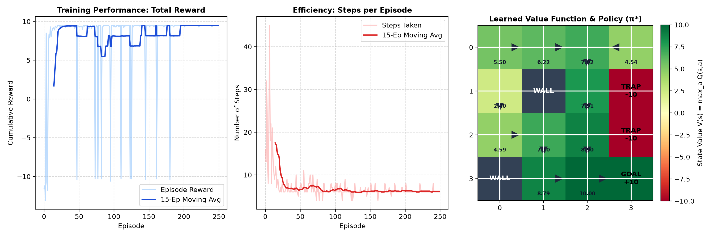

# 🤖 Reinforcement Learning Lab & Simulations

An interactive, beginner-to-advanced suite of **Reinforcement Learning** demonstrations designed for students, educators, and curious developers.

---

## 🏃 NEW: AI 100m Dash (Continuous Deep RL Humanoid Locomotion)

Inspired by AI Warehouse's viral YouTube demonstration [*AI vs. AI in 100m Dash (deep reinforcement learning)*](https://youtu.be/pJPdW8WWAso).

- **Interactive Web Simulation (`humanoid_dash_simulation.html`)**:
  - Run at 60 FPS in any browser with zero installations.
  - **4-Stage AI Championship**: Watch **Gen 0 (Flailer)**, **Gen 12 (Hopper)**, **Gen 45 (Galloper)**, and **Gen 120 (Olympic Sprinter)** race side-by-side to the 100m finish line.
  - **Live Evolution Lab**: Train populations of 12 agents live, adjust reward weights ($w_v, w_u, w_e$), and inspect neural policy activation in real time.
- **Desktop Python GUI (`humanoid_rl_demo.py`)**:
  - Native Tkinter + Numpy ragdoll simulation with camera tracking, physics collision impulses, and speed controls.
- **Compute & Architecture Guide (`HUMANOID_RUNNER_GUIDE.md`)**:
  - In-depth analysis of hardware compute requirements (CPU vs GPU vs Isaac Gym), reward engineering, and PPO continuous control.

Quick Launch:
```bash
python run_humanoid_demo.py
```

---

## 🗺️ Classical Reinforcement Learning: GridWorld Q-Learning

A clean, interactive, and beginner-friendly **Discrete Q-Learning** demonstration.

Built with Python, native Tkinter (zero heavy C-dependencies), and Matplotlib.

---

## 🌟 Key Features

- **Interactive Desktop GUI (`rl_classroom_gui.py`)**:
  - **Live Policy Visualization**: Watch directional arrows in each grid cell change color and point toward the optimal goal in real time.
  - **Step-by-Step Math Inspector**: See the exact Bellman Temporal Difference equation with live numerical substitutions on every step.
  - **Classroom Controls**: Step single actions, run full episodes, or fast-train 50/200 episodes.
  - **Real-Time Sliders**: Dynamically tune Learning Rate ($\alpha$), Discount Factor ($\gamma$), and Exploration Rate ($\epsilon$).
  - **Preset Maps**: Classic 4x4 Grid, Cliff Walking (4x8), and Maze (5x5).
- **Interactive Jupyter Notebook (`reinforcement_learning_for_beginners.ipynb`)**:
  - Theory, step-by-step code cells, explanations, and visual exercises for student lab sessions.
- **Standalone Benchmark Script (`q_learning_demo.py`)**:
  - Generates training performance curves and 2D state-value heatmaps.
- **Instructor's Teaching Guide (`TEACHING_GUIDE.md`)**:
  - 45–60 minute lecture plan, interactive discussion questions, and homework solutions.

---

## 📊 Training Results Preview



---

## 📂 Project Structure

```text
reinforcement_learning/
├── rl_classroom_gui.py                    # ⭐ Interactive Desktop GUI for live lectures
├── reinforcement_learning_for_beginners.ipynb # 📓 Complete Jupyter Notebook tutorial
├── q_learning_demo.py                     # 📊 Standalone script producing training curves & heatmaps
├── gridworld.py                           # 🗺️ Pedagogical GridWorld environment
├── q_agent.py                             # 🧠 Q-Learning agent with Bellman calculations
├── TEACHING_GUIDE.md                      # 🎓 45-60 min lecture plan & student exercises
├── requirements.txt                       # Minimal dependencies (numpy, matplotlib)
├── .gitignore                             # Git ignore rules
└── q_learning_results.png                 # Exported training plots
```

---

## 🚀 Quick Start

### 1. Installation
Clone this repository and install the minimal dependencies:
```bash
git clone <your-repo-url>
cd reinforcement_learning
pip install -r requirements.txt
```
*(Note: Tkinter is included in standard Python installations on Windows, macOS, and Linux).*

### 2. Launch the Desktop Simulation (Recommended for Lectures)
```bash
python rl_classroom_gui.py
```

#### Classroom GUI Controls:
- **`▶ Step (1 Action)`**: Advances the agent by one move and updates the live Bellman equation trace.
- **`⏩ Run 1 Episode`**: Runs a full episode animated at the chosen speed.
- **`⚡ Fast Train (50 / 200)`**: Rapidly trains multiple episodes in the background to show policy convergence.
- **`🗑 Clear Q-Table`**: Resets all learned values to zero to test new hyperparameters.
- **`↺ Reset Agent Pos`**: Resets the agent to Start without erasing learned Q-values.

### 3. Run Standalone Training & Plot Generation
```bash
python q_learning_demo.py
```
This trains the agent for 250 episodes and generates `q_learning_results.png` showing the rewards curve, steps taken, and the learned policy grid.

### 4. Open the Jupyter Notebook
Open `reinforcement_learning_for_beginners.ipynb` in VS Code or JupyterLab for student self-study.

---

## 📐 The Core Math Behind the Demo

The agent updates its Q-table using the **Temporal Difference (TD) Q-Learning rule**:

$$Q(s, a) \leftarrow Q(s, a) + \alpha \cdot \Big( \underbrace{r + \gamma \max_{a'} Q(s', a')}_{\text{TD Target}} - Q(s, a) \Big)$$

- $\alpha$ (**Learning Rate**): How aggressively the agent updates its beliefs with new rewards.
- $\gamma$ (**Discount Factor**): How much the agent values future rewards vs immediate rewards.
- $\epsilon$ (**Exploration Rate**): Probability of choosing a random action ($\epsilon$-greedy).

---

## 🎓 For Instructors

Check out **[`TEACHING_GUIDE.md`](TEACHING_GUIDE.md)** for:
- 45–60 minute lecture timeline.
- Interactive classroom experiments (e.g. *"What happens if $\gamma = 0$?"*, *"What happens if $\epsilon = 0$?"*).
- Student quiz and homework questions with solutions.

---

## 📄 License
MIT License. Free for educational and commercial use.
